# Wavevents: Complete Frontend Redux Toolkit Migration & Evaluation Defense Guide

**Project:** Wavevents (FDFED – Event Management and Post-Event Analytics)  
**Evaluation:** 3rd Project Evaluation (State Management Migration to Redux Toolkit)  
**Developer:** Vipul Chetan  
**Architecture Reference:** [StudentTrackerFE](https://github.com/mallikarjunreddyD/studentTrackerFE) (Professor Mallikarjun Reddy's Repository)  
**Build Status:** Clean Production Build (`vite build` succeeded with exit code 0)

---

## 1. Executive Summary & Mandatory Compliance

This migration transitions the entire Wavevents frontend state architecture to **Redux Toolkit (RTK)** using the exact design patterns, file conventions, and asynchronous Thunk practices demonstrated in the professor's reference repository.

### Core Architectural Rules Enforced:
1. **Redux as the Central Source of Truth:** Any server-backed and shared application data (authenticated user session, events catalogue, registered tickets, refunds, event proposals, quotations, operations/coordinators, staff roster, technical issues, real-time notifications, and post-event analytics) flows through the Redux Store.
2. **Professor's Exact Folder & File Structure:**
   - All slice definitions and thunk action files live flat inside `frontend/src/store/`.
   - Distinct separation between slice definitions (`<name>-slice.js`) and asynchronous thunk action creators (`<name>-actions.js`).
   - Central store configuration in `frontend/src/store/index.js` using `configureStore()`.
   - Top-level application wrap with `<Provider store={store}>` in `frontend/src/main.jsx`.
3. **No `createAsyncThunk` or RTK Query:** Standard Redux Thunk functions of the pattern `export const thunkName = (...) => (dispatch, getState) => { ... }` are used throughout, exactly matching the reference repository's `user-actions.js` and `student-actions.js`.
4. **Preserved Backend API Contracts:** All NestJS backend endpoints (`/api/*`), HTTP methods (`GET`, `POST`, `PUT`, `DELETE`), JWT headers (`Authorization: Bearer <token>`), and Vite proxy targets (`http://127.0.0.1:5001`) remain intact.

---

## 2. Redux Store Architecture Diagram

```mermaid
flowchart TD
    subgraph UI ["React Components (useSelector & useDispatch)"]
        APP["App.jsx & Navbar"]
        ATT["Attendee: ExploreEvents, EventDetails, MyTickets"]
        CLI["Client: Dashboard, CreateEvent, QuotationModals"]
        REV["Revenue: RevenueSpace, RefundManagement"]
        OPS["Operations: EventManagerSpace, OnsiteCoordinatorSpace"]
        ADM["Admin & IT: SuperAdminSpace, ITSupportSpace, DeptManager"]
        NOTIF["Notifications: ToastContainer & NotificationPanel"]
        ANL["Analytics: AnalyticsSpace & AttendeeFeedbackPanel"]
    end

    subgraph Actions ["Thunk Action Creators (src/store/*-actions.js)"]
        A_AUTH["auth-actions.js"]
        A_EVT["events-actions.js"]
        A_TCK["tickets-actions.js"]
        A_REQ["requests-actions.js"]
        A_REV["revenue-actions.js"]
        A_OPS["operations-actions.js"]
        A_USR["users-actions.js"]
        A_ISS["issues-actions.js"]
        A_NTF["notifications-actions.js"]
        A_ANL["analytics-actions.js"]
    end

    subgraph Store ["Central Redux Store (src/store/index.js)"]
        S_AUTH["authSlice (user, token, role)"]
        S_EVT["eventsSlice (events, selectedEvent)"]
        S_TCK["ticketsSlice (tickets, refunds)"]
        S_REQ["requestsSlice (requests, quotations, stats)"]
        S_REV["revenueSlice (dashboard, clients, refundMetrics)"]
        S_OPS["operationsSlice (manager, coordinator, scanner)"]
        S_USR["usersSlice (users, staff, teamHierarchy)"]
        S_ISS["issuesSlice (issues queue, tickets)"]
        S_NTF["notificationsSlice (unreadCount, alerts, toasts)"]
        S_ANL["analyticsSlice (kpis, comparisons, polls)"]
    end

    subgraph Backend ["NestJS Backend Controllers (/api/*)"]
        API["NestJS REST Endpoints (Port 5001)"]
    end

    UI -- "dispatch(thunkAction())" --> Actions
    Actions -- "HTTP Fetch (async)" --> Backend
    Backend -- "JSON Response" --> Actions
    Actions -- "dispatch(sliceActions.displayData())" --> Store
    Store -- "useSelector(state => state.*)" --> UI
```



---

## 3. The 10 Redux Slices & Action Creators

| # | Slice File | Actions File | State Shape | Key Thunk Action Creators |
|---|------------|--------------|-------------|----------------------------|
| 1 | `auth-slice.js` | `auth-actions.js` | `user`, `token`, `role`, `isAuthenticated`, `loading`, `error` | `fetchCurrentUser()`, `loginUser()`, `registerUser()`, `verifyEmail()`, `logoutUser()` |
| 2 | `events-slice.js` | `events-actions.js` | `events`, `selectedEvent`, `loading`, `error` | `fetchEventsData(filters)`, `fetchEventById(id)` |
| 3 | `tickets-slice.js` | `tickets-actions.js` | `tickets`, `refunds`, `selectedTicket`, `loading`, `error` | `fetchMyTickets()`, `fetchMyRefunds()`, `registerTicket()`, `claimTicketRefund()`, `retainTicket()` |
| 4 | `requests-slice.js` | `requests-actions.js` | `requests`, `changeRequests`, `activeQuotation`, `eventStats`, `reportStatus` | `fetchClientRequests()`, `fetchClientChangeRequests()`, `submitEventProposal()`, `fetchQuotationByRequestId()`, `acceptQuotationAction()`, `negotiateQuotationAction()`, `rejectQuotationAction()`, `payQuotationAdvanceAction()`, `submitChangeRequestAction()`, `fetchEventStats()`, `fetchReportStatus()` |
| 5 | `revenue-slice.js` | `revenue-actions.js` | `dashboardData`, `requestsList`, `clientsList`, `refundMetrics`, `refundsList`, `requestDetail`, `analyticsData` | `fetchRevenueDashboard()`, `fetchRevenueRequests()`, `fetchRevenueClients()`, `fetchRevenueAnalytics()`, `fetchRequestDetail()`, `saveQuotationDraftAction()`, `sendQuotationAction()`, `escalateEventAction()`, `fetchRefundMetrics()`, `fetchRefundsList()`, `approveRefundAction()`, `rejectRefundAction()` |
| 6 | `operations-slice.js` | `operations-actions.js` | `managerDashboard`, `managerEvents`, `coordinatorsList`, `activeWorkspace`, `coordinatorDashboard`, `coordinatorEvents`, `verifiedTicket`, `checkInResult` | `fetchManagerDashboard()`, `fetchManagerEvents()`, `fetchCoordinatorsList()`, `fetchEventWorkspaceDetails()`, `markEventReadyAction()`, `assignCoordinatorsAction()`, `updateEventConfigurationAction()`, `fetchCoordinatorDashboard()`, `fetchCoordinatorEvents()`, `verifyTicketOnsite()`, `checkInAttendee()` |
| 7 | `users-slice.js` | `users-actions.js` | `users`, `teamMembers`, `awaitingEvents`, `assignedEvents`, `totalCount` | `fetchUserData()`, `createUserAction()`, `updateUserRoleAction()`, `fetchDepartmentTeam()`, `fetchAwaitingEvents()`, `assignEventManagerAction()` |
| 8 | `issues-slice.js` | `issues-actions.js` | `issues`, `loading`, `error` | `fetchIssuesData()`, `createTechnicalIssue()`, `assignIssueAction()`, `resolveIssueAction()`, `escalateIssueAction()` |
| 9 | `notifications-slice.js` | `notifications-actions.js` | `notifications`, `pendingToasts`, `unreadCount`, `loading`, `error` | `fetchNotificationsData()`, `fetchPendingToasts()`, `markNotificationReadAction()`, `markAllNotificationsReadAction()`, `clearAllNotificationsAction()`, `autoExpireNotificationsAction()` |
| 10 | `analytics-slice.js` | `analytics-actions.js` | `analyticsDashboard`, `eventAnalytics`, `comparisonData`, `activePolls` | `fetchAnalyticsDashboard()`, `fetchEventAnalyticsById()`, `fetchAnalyticsComparison()`, `fetchActiveFeedbackPolls()`, `submitPollResponse()` |

---

## 4. Frontend Component Migration Inventory

The table below catalogs every component modified and connected to Redux:

| Component Path | Redux Hook Inputs (`useSelector`) | Dispatched Actions (`useDispatch`) |
|----------------|-----------------------------------|------------------------------------|
| `frontend/src/main.jsx` | N/A (Root Store Provider) | Wraps App with `<Provider store={store}>` |
| `frontend/src/App.jsx` | `auth.user`, `auth.token`, `events.events`, `events.selectedEvent` | `fetchEventsData()`, `fetchCurrentUser()`, `logoutUser()`, `eventsActions.setSelectedEvent()` |
| `frontend/src/auth/AuthModal.jsx` | `auth.loading`, `auth.error` | `loginUser()`, `registerUser()`, `verifyEmail()` |
| `frontend/src/actors/attendee/pages/ExploreEvents.jsx` | `events.events`, `events.loading` | `fetchEventsData()` |
| `frontend/src/actors/attendee/pages/EventDetails.jsx` | `events.selectedEvent`, `auth.user` | `eventsActions.setSelectedEvent()`, `fetchEventById()` |
| `frontend/src/actors/attendee/pages/MyTickets.jsx` | `tickets.tickets`, `tickets.refunds` | `fetchMyTickets()`, `fetchMyRefunds()`, `claimTicketRefund()`, `retainTicket()` |
| `frontend/src/actors/attendee/components/PaymentModal.jsx` | `auth.user`, `auth.token` | `registerTicket(payload)` |
| `frontend/src/actors/attendee/components/CancelTicketModal.jsx` | `auth.token` | `claimTicketRefund(ticketId, reason)` |
| `frontend/src/actors/attendee/components/AttendeeFeedbackPanel.jsx` | `analytics.activePolls` | `fetchActiveFeedbackPolls()`, `submitPollResponse()` |
| `frontend/src/actors/client/pages/Dashboard.jsx` | `requests.requests`, `requests.changeRequests`, `tickets.tickets`, `tickets.refunds`, `requests.eventStats`, `requests.reportStatus` | `fetchClientRequests()`, `fetchClientChangeRequests()`, `fetchMyTickets()`, `fetchMyRefunds()`, `fetchEventStats()`, `fetchReportStatus()` |
| `frontend/src/actors/client/pages/CreateEvent.jsx` | `auth.user` | `submitEventProposal()`, `fetchCurrentUser()` |
| `frontend/src/actors/client/components/QuotationViewModal.jsx` | `requests.activeQuotation` | `fetchQuotationByRequestId()`, `acceptQuotationAction()`, `negotiateQuotationAction()`, `rejectQuotationAction()` |
| `frontend/src/actors/client/components/QuotationPaymentModal.jsx` | N/A | `payQuotationAdvanceAction()` |
| `frontend/src/actors/client/components/ChangeRequestModal.jsx` | N/A | `submitChangeRequestAction()` |
| `frontend/src/actors/revenue/pages/RevenueSpace.jsx` | `revenue.dashboardData`, `revenue.requestsList`, `revenue.clientsList`, `revenue.analyticsData`, `revenue.requestDetail` | `fetchRevenueDashboard()`, `fetchRevenueRequests()`, `fetchRevenueClients()`, `fetchRevenueAnalytics()`, `fetchRequestDetail()`, `saveQuotationDraftAction()`, `sendQuotationAction()`, `escalateEventAction()` |
| `frontend/src/actors/revenue/components/RefundManagementSection.jsx` | `revenue.refundMetrics`, `revenue.refundsList` | `fetchRefundMetrics()`, `fetchRefundsList(filters)` |
| `frontend/src/actors/revenue/components/RefundActionModal.jsx` | N/A | `approveRefundAction()`, `rejectRefundAction()` |
| `frontend/src/actors/event-manager/pages/EventManagerSpace.jsx` | `operations.managerDashboard`, `operations.managerEvents`, `operations.coordinatorsList`, `operations.activeWorkspace` | `fetchManagerDashboard()`, `fetchManagerEvents()`, `fetchCoordinatorsList()`, `fetchEventWorkspaceDetails()`, `updateEventConfigurationAction()`, `assignCoordinatorsAction()`, `markEventReadyAction()` |
| `frontend/src/actors/onsite-coordinator/pages/OnsiteCoordinatorSpace.jsx` | `operations.coordinatorDashboard`, `operations.coordinatorEvents` | `fetchCoordinatorDashboard()`, `fetchCoordinatorEvents()`, `verifyTicketOnsite()`, `checkInAttendee()` |
| `frontend/src/actors/event-management/pages/DepartmentManagerSpace.jsx` | `issues.issues`, `users.teamMembers`, `users.awaitingEvents`, `users.assignedEvents` | `fetchIssuesData()`, `fetchDepartmentTeam()`, `fetchAwaitingEvents()`, `resolveIssueAction()`, `escalateIssueAction()` |
| `frontend/src/actors/admin/pages/SuperAdminSpace.jsx` | `issues.issues`, `users.users` | `fetchIssuesData()`, `fetchUserData()`, `resolveIssueAction()` |
| `frontend/src/actors/admin/pages/ITSupportSpace.jsx` | `issues.issues` | `fetchIssuesData()`, `assignIssueAction()`, `resolveIssueAction()`, `escalateIssueAction()` |
| `frontend/src/shared/components/UserManagementSection.jsx` | `users.users`, `users.totalCount` | `fetchUserData()`, `createUserAction()` |
| `frontend/src/shared/components/ReportTechnicalIssueModal.jsx` | N/A | `createTechnicalIssue()` |
| `frontend/src/shared/components/Navbar.jsx` | `notifications.unreadCount` | `fetchNotificationsData()` |
| `frontend/src/shared/components/NotificationPanel.jsx` | `notifications.notifications`, `notifications.unreadCount` | `fetchNotificationsData()`, `markNotificationReadAction()`, `markAllNotificationsReadAction()`, `clearAllNotificationsAction()` |
| `frontend/src/shared/components/NotificationToastContainer.jsx` | `notifications.pendingToasts` | `fetchPendingToasts()`, `autoExpireNotificationsAction()` |
| `frontend/src/shared/pages/AnalyticsSpace.jsx` | `analytics.analyticsDashboard`, `analytics.eventAnalytics`, `analytics.comparisonData` | `fetchAnalyticsDashboard()`, `fetchEventAnalyticsById()`, `fetchAnalyticsComparison()` |

---

## 5. Verification & Build Proof

The entire frontend package was validated using the Vite production compiler.
```bash
$ cd frontend
$ npm run build

> wavevents-frontend@1.0.0 build
> vite build

vite v6.4.6 building for production...
transforming...
✓ 1675 modules transformed.
rendering chunks...
computing gzip size...
dist/index.html                     1.22 kB │ gzip:   0.66 kB
dist/assets/index-CTETG6E9.css    123.87 kB │ gzip:  17.62 kB
dist/assets/index-BXh_GAcF.js   1,056.75 kB │ gzip: 231.46 kB
✓ built in 13.37s
```
**Result:** 0 syntax errors, 0 broken imports, 100% clean production build.

---

## 6. Project Evaluation Defense & Viva Q&A Guide

When presenting this implementation to your professor during your 3rd evaluation, use the structured explanations below:

### Q1: Why did you separate `*-slice.js` and `*-actions.js` instead of putting everything into `createSlice` or using `createAsyncThunk`?
> **Answer:**  
> "We followed the exact architecture taught by our professor in the `studentTrackerFE` repository. In that reference implementation, `createSlice` handles synchronous, pure reducer actions that update the state. The asynchronous API requests and side effects are separated into dedicated thunk functions inside `*-actions.js`. Standard Redux Thunk action creators return `(dispatch, getState) => { ... }`. This keeps our reducers clean and deterministic, allows easy access to auth tokens via `getState()`, and ensures that our code structure strictly matches the course standards."

### Q2: How did you satisfy the requirement: *"Any data should come from the Redux store"*?
> **Answer:**  
> "Previously, several components maintained their own local `useState` arrays that were populated with independent `fetch()` calls. In our migrated architecture:
> 1. The component dispatches a thunk action creator (e.g., `dispatch(fetchEventsData())`).
> 2. The thunk queries the NestJS backend API.
> 3. Upon receiving the JSON response, the thunk dispatches a synchronous slice action (e.g., `eventsActions.displayEvents(data.events)`).
> 4. The slice reducer updates the Redux store.
> 5. The component reads this data purely via `useSelector(state => state.events.events)`.
> Local `useState` is now strictly reserved for ephemeral UI controls—such as modal toggle flags (`isOpen`), active form text inputs before submission, and local pagination indexes."

### Q3: How is the store structured and registered?
> **Answer:**  
> "Our store is configured inside `src/store/index.js` using Redux Toolkit's `configureStore()`. We registered all 10 slice reducers under clear, predictable keys: `auth`, `events`, `tickets`, `requests`, `revenue`, `operations`, `users`, `issues`, `notifications`, and `analytics`. At the entry point of the application (`src/main.jsx`), the root React tree is wrapped in `<Provider store={store}>`, making the entire global state accessible across every component."

### Q4: How is JWT authentication handled within asynchronous thunks?
> **Answer:**  
> "Rather than hardcoding authentication tokens or reading them directly in every component, our thunk actions inspect the Redux auth state using `getState().auth.token` (with fallback to `localStorage.getItem('ffsd_token')`). The token is attached as `Authorization: Bearer <token>` in the HTTP headers before making the request. When a user logs in or out, `auth-slice.js` synchronously updates `state.token` and `state.user`, immediately propagating the authorization state throughout all dependent slices."

### Q5: How do role-based access rules interact with Redux?
> **Answer:**  
> "The authenticated user's role is stored in `state.auth.user.role`. Both the navigation bar (`Navbar.jsx`) and the route switcher (`App.jsx`) select `state.auth.user` to determine which dashboard to render (Attendee, Client, Revenue Specialist, Event Manager, Onsite Coordinator, Department Head, or Super Admin). Furthermore, thunks like `revenue-actions.js` read `getState().auth.user.role` to attach appropriate role headers (`x-role`) when communicating with administrative NestJS backend endpoints."
